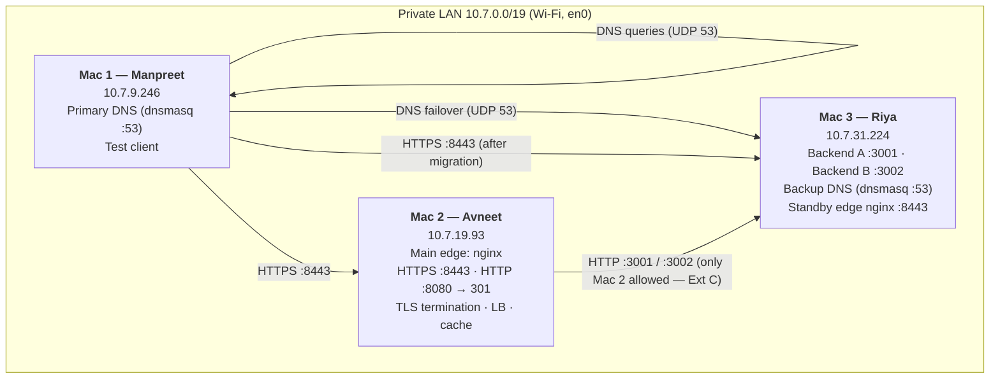
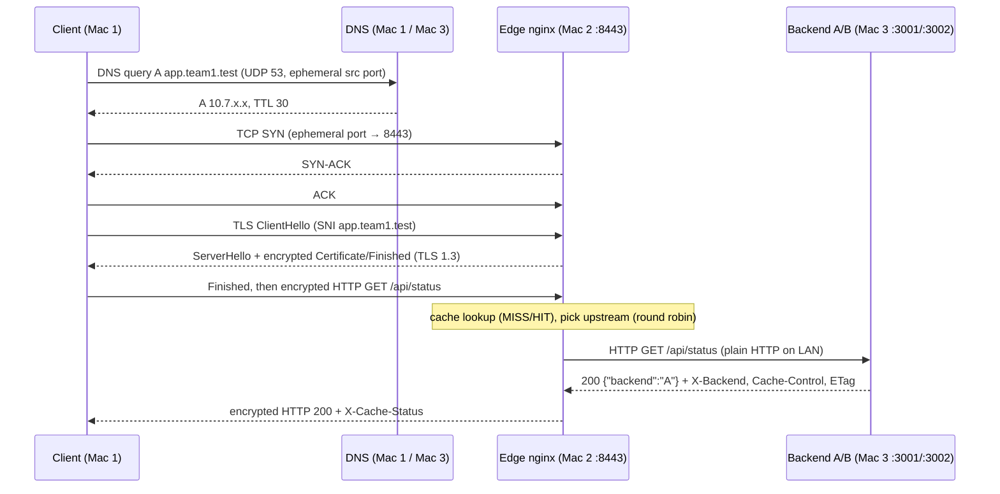
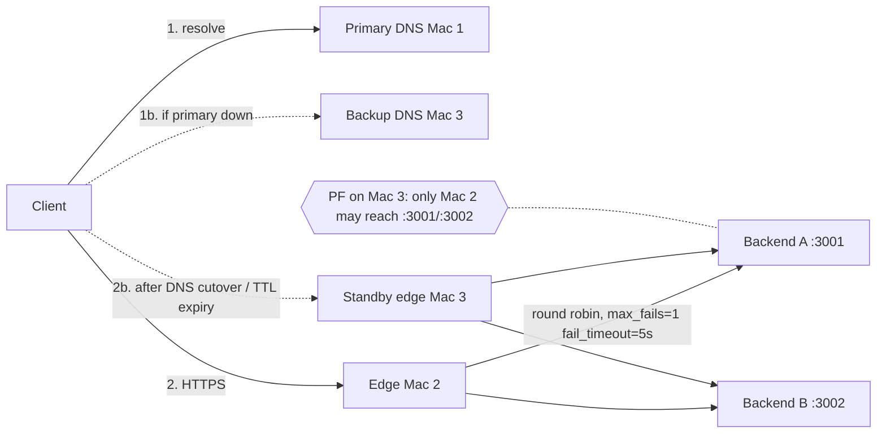
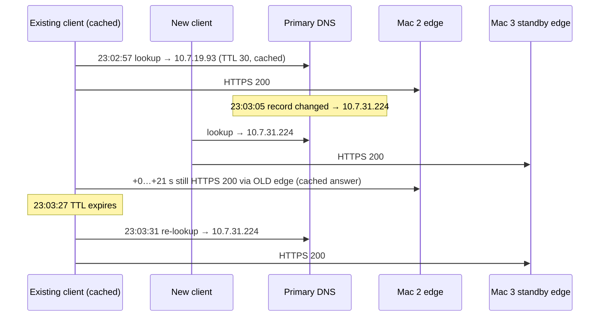

# Architecture Diagrams — Team Error-101 (3-Mac adaptation)

## 1. Network topology and roles (private LAN 10.7.0.0/19, gateway 10.7.0.1, Wi-Fi en0)

| Machine | IP | MAC | Services | Cloud equivalent |
|---|---|---|---|---|
| Mac 1 | 10.7.9.246 | 36:b5:ac:b7:11:00 | dnsmasq (primary), client tools | Route 53 / managed DNS |
| Mac 2 | 10.7.19.93 | 2e:30:0b:a1:32:2a | nginx edge: TLS, round-robin LB, proxy cache | ALB / CDN edge |
| Mac 3 | 10.7.31.224 | 46:b2:52:34:a6:e0 | Node/Express A+B, dnsmasq (backup), standby nginx | EC2 app servers, secondary DNS, standby LB |

## 2. One request, layer by layer

| Layer | Protocol | Ports in this project |
|---|---|---|
| Application | DNS, HTTP/1.1 (REST/JSON) | 53, 8080 (→301), 3001, 3002 |
| Session/presentation (TLS) | TLS 1.3 | 8443 |
| Transport | UDP (DNS), TCP (HTTP/TLS) | client ephemeral ports ↔ well-known/service ports |
| Network | IPv4 | 10.7.0.0/19 |
| Link | Wi-Fi 802.11 / Ethernet frames | en0 MAC addresses above |

## 3. Phase 2 resilience features

## 4. Extension E — DNS-based cutover timeline (measured 2026-11-23)

## Remaining single points of failure
- **Mac 3** hosts both backends, the backup DNS and the standby edge → one machine failure takes out the application tier.
- The **edge** is still one IP per DNS record: switching edges relies on DNS + TTL (seconds to minutes), not instant.
  Removing it needs a floating/virtual IP (VRRP/keepalived), anycast, or a DNS health-checked failover (e.g. Route 53 failover records) in front of ≥2 active edges.
- Single Wi-Fi network / access point and DHCP-assigned IPs (IPs changed during the project).
